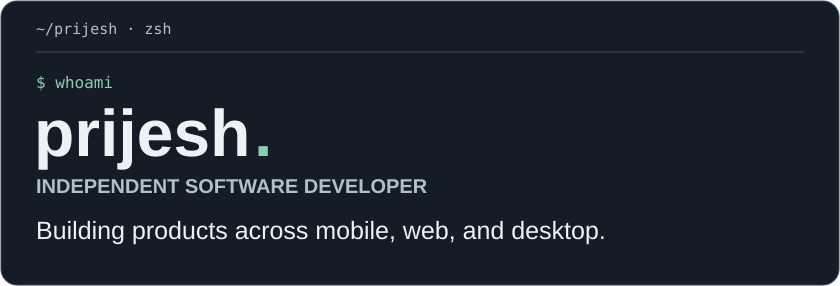
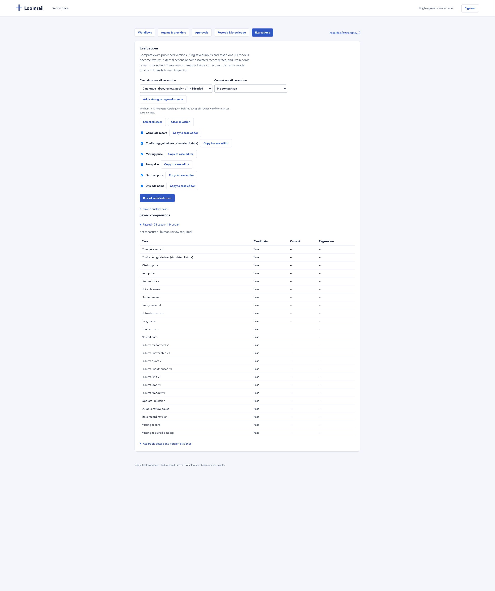

<picture>
  <source media="(max-width: 600px)" srcset="./assets/01-hero-mobile.svg" />
  
</picture>

# Prijesh Bikram Shahi

Independent software developer in **Kathmandu, Nepal**, building products across **mobile, web, and desktop**.

I care about the details between an interface and the system behind it: clear state, deliberate actions, local persistence, and useful failure messages.

[Portfolio](https://prijeshbikramshahi.com.np) · [Résumé](https://prijeshbikramshahi.com.np/resume) · [LinkedIn](https://www.linkedin.com/in/prijeshbikramshahi/)

## Selected work

Four projects, from native interfaces to backend workflows. Each links to implementation evidence and its current boundaries.

### Stow

A local Git workspace manager for discovering repositories, inspecting changes, and reviewing clone and sync operations.

- **Stack:** Tauri 2 · Rust · React · TypeScript · SQLite
- **Engineering:** A persistent repository registry, operation journals, and explicit confirmation before supported Git mutations.
- **Status:** Source build for macOS; distribution signing and other platforms remain unverified.

[Repository](https://github.com/PrijeshBikramShahi/stow) · [Architecture](https://github.com/PrijeshBikramShahi/stow/blob/master/docs/ARCHITECTURE.md) · [Git operation tests](https://github.com/PrijeshBikramShahi/stow/blob/master/src-tauri/src/pull_tests.rs) · [Verification notes](https://github.com/PrijeshBikramShahi/stow/blob/master/docs/VERIFICATION.md)

### Topside

A macOS island for time, battery status, and Spotify controls, with hover previews and pinned interactions.

- **Stack:** Swift · AppKit · SwiftUI · IOKit
- **Engineering:** Platform services feed a separate core for interaction, layout, and battery logic, with regression tests.
- **Status:** Source build for macOS 13+; broader device and accessibility validation is pending.

[Repository & build](https://github.com/PrijeshBikramShahi/topside) · [Core architecture](https://github.com/PrijeshBikramShahi/topside/blob/master/Package.swift) · [Interaction tests](https://github.com/PrijeshBikramShahi/topside/blob/master/Tests/TopsideCoreTests/InteractionReducerTests.swift)

*Application screenshot from the Topside repository.*

### Khoj

A Flutter demonstration for planning multi-stop routes with OpenStreetMap tiles, Nominatim geocoding, and OSRM routing.

- **Stack:** Dart · Flutter · Provider · REST APIs
- **Engineering:** A layered entry point separates map state, domain use cases, and HTTP data sources; small tests cover coordinate validation and result handling.
- **Status:** Architecture migration in progress; no saved route history or offline maps.

[Repository & run](https://github.com/PrijeshBikramShahi/khoj-app) · [Architecture](https://github.com/PrijeshBikramShahi/khoj-app/blob/master/ARCHITECTURE_SUMMARY.md) · [Tests](https://github.com/PrijeshBikramShahi/khoj-app/blob/master/test/widget_test.dart)

### Loomrail

A local web workspace for visual agent workflows, persisted execution, and review of proposed record changes before they are applied.

- **Stack:** TypeScript · React · Fastify · Node.js · SQLite
- **Engineering:** Versioned contracts, checkpointed runs, approval revision checks, and isolated fixture evaluations.
- **Status:** Single-operator local application. The recorded walkthrough uses deterministic fixtures; it does not establish live model quality.

[Repository](https://github.com/PrijeshBikramShahi/loomrail) · [Architecture decisions](https://github.com/PrijeshBikramShahi/loomrail/tree/master/docs/decisions) · [Tests](https://github.com/PrijeshBikramShahi/loomrail/tree/master/apps/server/test) · [CI](https://github.com/PrijeshBikramShahi/loomrail/actions/workflows/check.yml) · [Walkthrough](https://github.com/PrijeshBikramShahi/loomrail/blob/master/docs/demo/WALKTHROUGH.md) · [Limitations](https://github.com/PrijeshBikramShahi/loomrail/blob/master/docs/LIMITATIONS.md)

View Loomrail's fixture evaluation screenshot

*Repository screenshot of a saved deterministic evaluation, not a live CI result or model benchmark.*

## More work

- **[Accord](https://github.com/PrijeshBikramShahi/accord)** · Client collaboration around versioned scope, deliverable reviews, and approvals. The cloud preview covers a narrower workflow than the local application.
- **[CodeRoom](https://github.com/PrijeshBikramShahi/coderoom)** · Collaborative editing prototype using Next.js, WebSockets, and Operational Transform.
- **[Widgion](https://github.com/PrijeshBikramShahi/mac-widget-platform)** · Native macOS widgets and system integrations, with screenshots and behavior checks in the repository.

## Engineering toolkit

Tools used in the projects above, grouped by purpose rather than proficiency ratings.

- **Languages:** TypeScript, JavaScript, Rust, Swift, Dart, Python.
- **Interfaces:** React, Next.js, Flutter, AppKit, SwiftUI.
- **Backend & data:** Node.js, Fastify, REST APIs, SQLite.
- **Desktop & delivery:** Tauri, Git, Swift Package Manager, GitHub Actions.

In practice, I focus on **recoverable operations** in Stow, **testable platform logic** in Topside, **API and state boundaries** in Khoj, and **reviewable execution** in Loomrail. The architecture and test links above show those decisions in code.

## Currently exploring

Further work on local-first tools and supervised AI workflows. **Oryn, Aevro, and Dovra** are ongoing explorations; I’ll feature them here when there is public implementation evidence to inspect.

## Connect

For product work and collaboration: [Email](mailto:prijeshshahi0@gmail.com) · [Portfolio](https://prijeshbikramshahi.com.np) · [Résumé](https://prijeshbikramshahi.com.np/resume) · [LinkedIn](https://www.linkedin.com/in/prijeshbikramshahi/).
