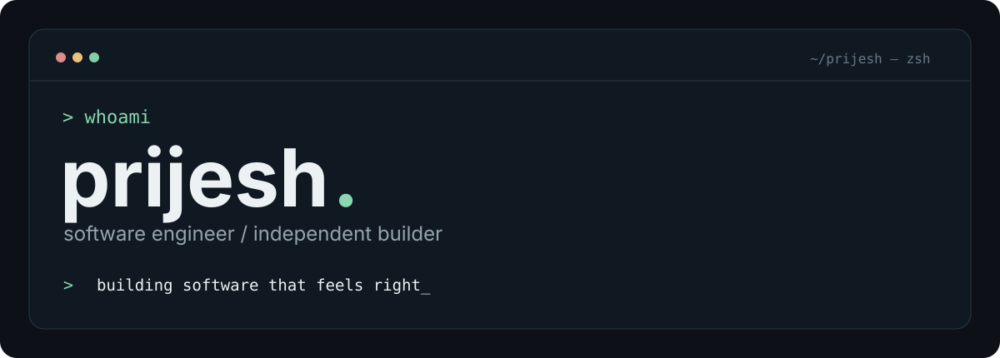
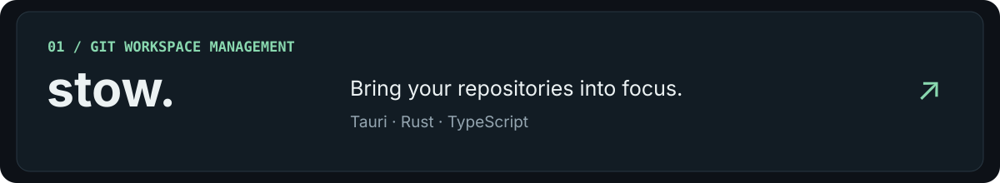
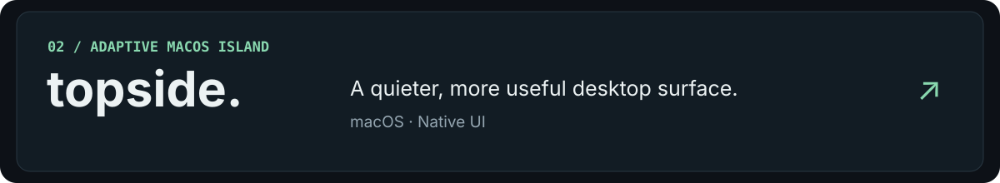
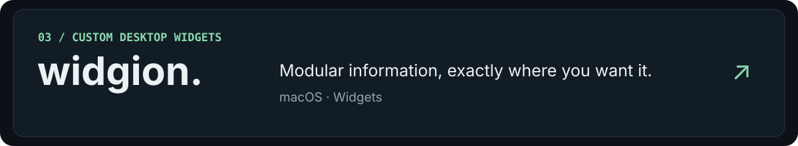
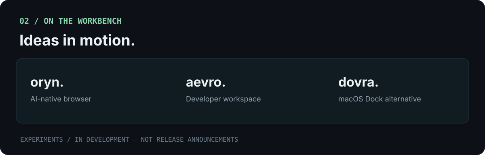
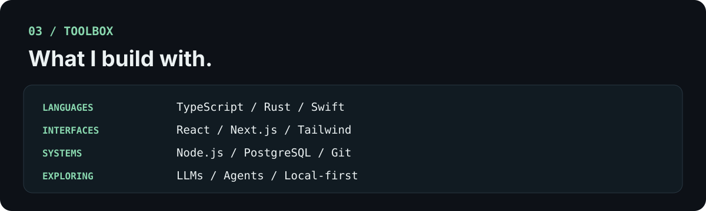

<!-- Premium profile: SVG artwork with ordinary clickable links. SVGs contain no scripts or external assets. -->

  

  

  
  
  

  
  
  

About me &amp; quick links

I'm **Prijesh Bikram Shahi**, a software engineer based in Nepal. I build developer tools, desktop utilities, and AI-assisted workflows with a focus on practical design and local-first software.

- [Stow](https://github.com/PrijeshBikramShahi/stow) — Git workspace management
- [Topside](https://github.com/PrijeshBikramShahi/Topside) — adaptive macOS island
- [Widgion](https://github.com/PrijeshBikramShahi/mac-widget-platform) — macOS widgets

