<!-- All visual content is local SVG. All project cards are clickable. -->

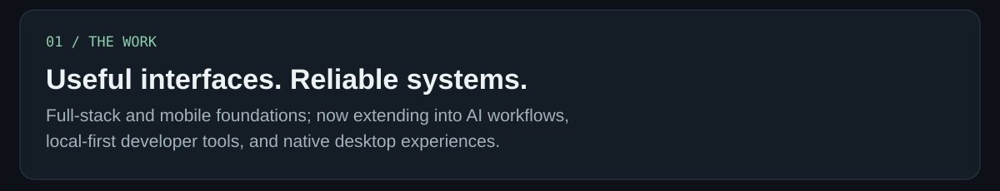
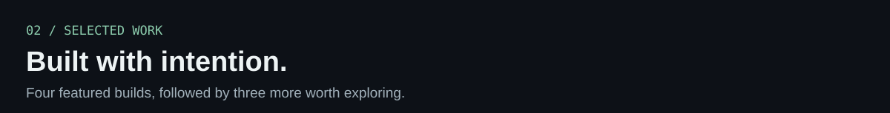

<!-- Featured work: 2-column grid, each entire card links to its repository -->
<table><tr>
<td width="50%"><a href="https://github.com/PrijeshBikramShahi/stow">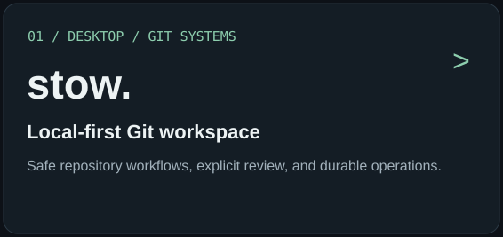</a></td>
<td width="50%"><a href="https://github.com/PrijeshBikramShahi/loomrail">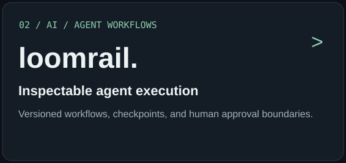</a></td>
</tr><tr>
<td width="50%"><a href="https://github.com/PrijeshBikramShahi/coderoom">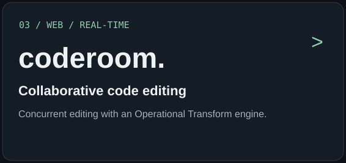</a></td>
<td width="50%"><a href="https://github.com/PrijeshBikramShahi/accord">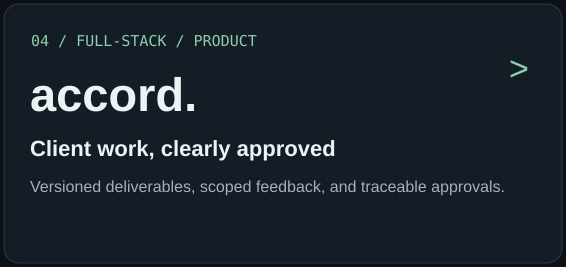</a></td>
</tr></table>

<!-- More work: 3-column row -->
<table><tr>
<td width="33%"><a href="https://github.com/PrijeshBikramShahi/topside">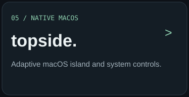</a></td>
<td width="33%"><a href="https://github.com/PrijeshBikramShahi/mac-widget-platform">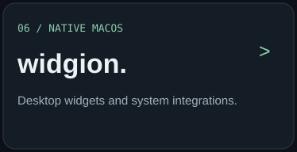</a></td>
<td width="33%"><a href="https://github.com/PrijeshBikramShahi/khoj-app">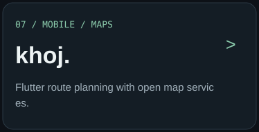</a></td>
</tr></table>

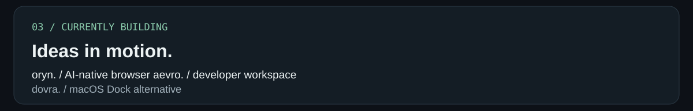
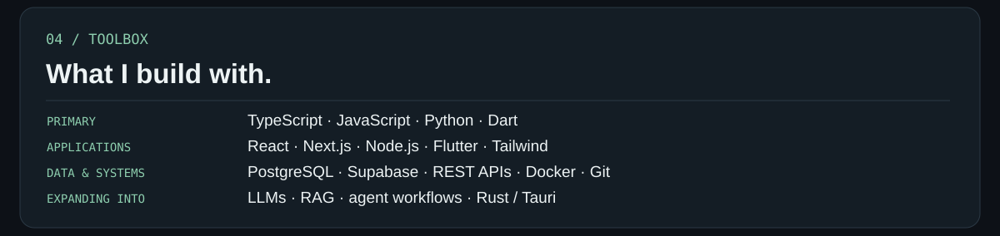
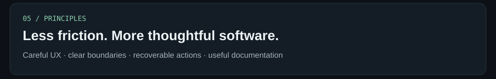

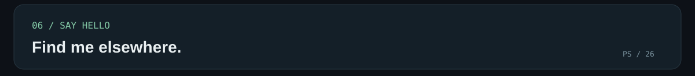

  &nbsp;&nbsp;
  &nbsp;&nbsp;
  &nbsp;&nbsp;
  

